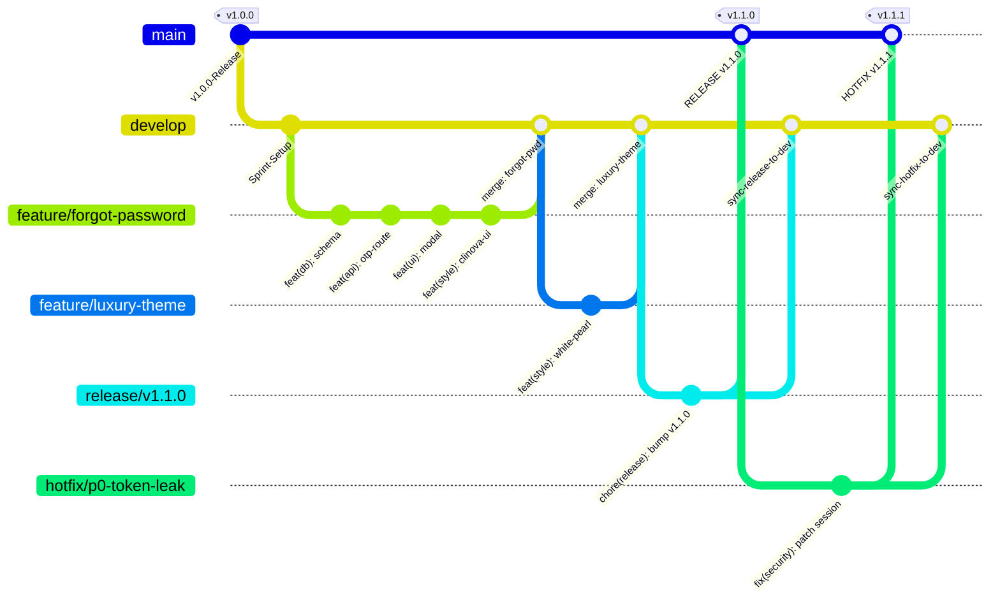
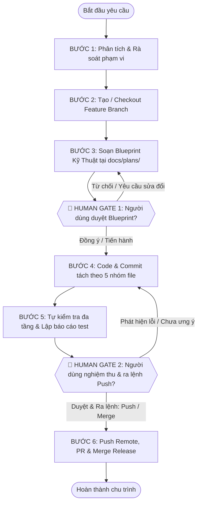

# CẨM NANG QUY CHUẨN GIT & WORKFLOW TOÀN DIỆN (ENTERPRISE GIT WORKFLOW STANDARD)
## Hệ Thống Salon Hair Cao Cấp & Trợ Lý AI Kỹ Thuật (Antigravity AI-Augmented Engineering)
> **MÃ HIỆU QUY CHUẨN:** `STD-GIT-WORKFLOW-2026-V3.0`  
> **CẤP ĐỘ ÁP DỤNG:** BẮT BUỘC (MANDATORY) CHO TẤT CẢ KỸ SƯ, ANTIMATTER / ANTIGRAVITY AGENTS VÀ TRỢ LÝ AI  
> **PHIÊN BẢN HIỆN HÀNH:** 3.0.0 (CẬP NHẬT TOÀN DIỆN THÁNG 10/2026)  
> **PHẠM VI ĐIỀU CHỈNH:** TOÀN BỘ REPOSITORY `duanAI` (HỆ THỐNG QUẢN LÝ SALON HAIR HÀ MINH)

---

## MỤC LỤC CHI TIẾT
- [LỜI MỞ ĐẦU & TUYÊN NGÔN BẢO VỆ MÃ NGUỒN](#lời-mở-đầu--tuyên-ngôn-bảo-vệ-mã-nguồn)
- [CHƯƠNG 1: TRIẾT LÝ & 5 NGUYÊN TẮC VÀNG](#chương-1-triết-lý--5-nguyên-tắc-vàng)
- [CHƯƠNG 2: KIẾN TRÚC PHÂN NHÁNH DOANH NGHIỆP](#chương-2-kiến-trúc-phân-nhánh-doanh-nghiệp)
- [CHƯƠNG 3: LUỒNG XỬ LÝ 6 BƯỚC TUẦN TỰ & 2 CỔNG CHẶN HUMAN GATES](#chương-3-luồng-xử-lý-6-bước-tuần-tự--2-cổng-chặn-human-gates)
  - [BƯỚC 1: Phân Tích Yêu Cầu & Rà Soát Phạm Vi Toàn Diện](#bước-1-phân-tích-yêu-cầu--rà-soát-phạm-vi-toàn-diện)
  - [BƯỚC 2: Quản Lý Phân Nhánh Git](#bước-2-quản-lý-phân-nhánh-git)
  - [BƯỚC 3: Lập Blueprint Kỹ Thuật Tại `docs/plans/<ten-feature>.md`](#bước-3-lập-blueprint-kỹ-thuật-tại-docsplansten-featuremd)
  - [🛑 ĐIỂM DỪNG BẮT BUỘC 1 (HUMAN GATE 1)](#-điểm-dừng-bắt-buộc-1-human-gate-1)
  - [BƯỚC 4: Hiện Thực Hóa Mã Nguồn & Quy Tắc Commit Nguyên Tử 5 Nhóm](#bước-4-hiện-thực-hóa-mã-nguồn--quy-tắc-commit-nguyên-tử-5-nhóm)
  - [BƯỚC 5: Tự Kiểm Tra Đa Tầng & Lập Báo Cáo Nghiệm Thu](#bước-5-tự-kiểm-tra-đa-tầng--lập-báo-cáo-nghiệm-thu)
  - [🛑 ĐIỂM DỪNG BẮT BUỘC 2 (HUMAN GATE 2)](#-điểm-dừng-bắt-buộc-2-human-gate-2)
  - [BƯỚC 6: Đóng Gói, Push Remote, Tạo PR & Merge Release](#bước-6-đóng-gói-push-remote-tạo-pr--merge-release)
- [CHƯƠNG 4: QUY CHUẨN COMMIT NGUYÊN TỬ (ATOMIC COMMITS SPECIFICATION)](#chương-4-quy-chuẩn-commit-nguyên-tử-atomic-commits-specification)
- [CHƯƠNG 5: CẨM NANG THAO TÁC GIT THỰC CHIẾN NÂNG CAO](#chương-5-cẩm-nang-thao-tác-git-thực-chiến-nâng-cao)
  - [5.1 Quy Trình Giải Quyết Xung Đột Merge (Conflict Resolution SOP)](#51-quy-trình-giải-quyết-xung-đột-merge-conflict-resolution-sop)
  - [5.2 Kỹ Thuật Interactive Rebase (`git rebase -i`)](#52-kỹ-thuật-interactive-rebase-git-rebase--i)
  - [5.3 Kỹ Thuật Git Stash Nâng Cao](#53-kỹ-thuật-git-stash-nâng-cao)
  - [5.4 Kỹ Thuật Git Cherry-Pick An Toàn](#54-kỹ-thuật-git-cherry-pick-an-toàn)
  - [5.5 Kỹ Thuật Git Bisect Truy Vết Lỗi Hồi Quy](#55-kỹ-thuật-git-bisect-truy-vết-lỗi-hồi-quy)
- [CHƯƠNG 6: QUY TRÌNH HOTFIX KHẨN CẤP & ROLLBACK AN TOÀN TRÊN PRODUCTION](#chương-6-quy-trình-hotfix-khẩn-cấp--rollback-an-toàn-trên-production)
- [CHƯƠNG 7: MA TRẬN TRÁCH NHIỆM RACI & QUY TẮC BẢO VỆ BÍ MẬT](#chương-7-ma-trận-trách-nhiệm-raci--quy-tắc-bảo-vệ-bí-mật)
- [CHƯƠNG 8: CẨM NANG GỠ RỐI GIT (GIT TROUBLESHOOTING CHEAT SHEET - 15 KỊCH BẢN)](#chương-8-cẩm-nang-gỡ-rối-git-git-troubleshooting-cheat-sheet---15-kịch-bản)
- [CHƯƠNG 9: PRE-FLIGHT CHECKLIST TRƯỚC MỖI PHẢN HỒI](#chương-9-pre-flight-checklist-trước-mỗi-phản-hồi)

---

## LỜI MỞ ĐẦU & TUYÊN NGÔN BẢO VỆ MÃ NGUỒN

Trong môi trường kỹ thuật hiện đại kết hợp giữa trí tuệ nhân tạo (AI Agent) và lập trình viên con người (Human Engineer), tính toàn vẹn của mã nguồn, độ tin cậy của lịch sử phiên bản và sự ổn định của hệ thống sản phẩm (Production) là sinh mệnh của dự án. 

Trợ lý AI là một cỗ máy xử lý tốc độ cao, nhưng **tuyệt đối không được phép biến thành một chiếc xe mất phanh**. Mọi thay đổi mã nguồn, dù nhỏ như một dòng CSS hay lớn như một bản di trú cơ sở dữ liệu (Database Migration), đều phải tuân theo trật tự kỷ luật nghiêm ngặt, minh bạch, có thể đảo ngược (reversible) và chịu sự kiểm soát tối cao của con người.

Tài liệu này được biên soạn nhằm chuẩn hóa toàn bộ các hoạt động Git, định nghĩa ranh giới quyền hạn, thiết lập các cổng kiểm soát chất lượng (Human Gates) và cung cấp cẩm nang xử lý mọi tình huống kỹ thuật từ đơn giản đến phức tạp trong dự án.

---

## CHƯƠNG 1: TRIẾT LÝ & 5 NGUYÊN TẮC VÀNG

Mọi cá nhân và tác tử AI tham gia vào repository này PHẢI thấm nhuần và tuân thủ vô điều kiện 5 nguyên tắc sau:

### 1.1 Human-in-the-Loop (Con Người Nắm Quyền Tối Thượng)
- Trợ lý AI là **người thực thi có trách nhiệm** (Responsible executor), nhưng lập trình viên con người là **người chịu trách nhiệm cuối cùng và nắm quyền phê duyệt** (Accountable Approver).
- AI KHÔNG ĐƯỢC PHÉP tự ý đưa ra các quyết định kiến trúc then chốt mà không có sự đồng thuận.
- AI KHÔNG ĐƯỢC PHÉP tự ý đẩy mã nguồn lên server từ xa (remote repository) hoặc gộp nhánh (merge) vào các nhánh xương sống khi chưa có lệnh rõ ràng từ người dùng.

### 1.2 Zero-Assumption & Active Clarification (Tuyệt Đối Không Đoán Mò)
- Khi nhận một yêu cầu chưa đủ thông số kỹ thuật (ví dụ: *"cho quên mk"*, *"sửa giao diện nhìn cho dễ"*), Agent không được tự suy đoán logic nghiệp vụ theo ý thích chủ quan.
- Agent BẮT BUỘC phải đặt câu hỏi làm rõ các khía cạnh: kênh gửi mã (SMS/Zalo/Email), quy tắc định dạng, đối tượng áp dụng, tác động tới CSDL hiện hành.

### 1.3 Atomic Commits & Categorized Staging (Commit Nguyên Tử Theo Phân Nhóm)
- **CẤM TUYỆT ĐỐI** lệnh `git add .` hoặc `git commit -a` gom tất cả các file sửa đổi vào một commit khổng lồ vô nghĩa.
- Mỗi commit phải biểu diễn một đơn vị thay đổi logic nguyên tử (Atomic Unit of Change). Nếu một tính năng đụng tới cả CSDL, Backend, Template và File tĩnh (CSS/JS), các file này PHẢI được chia tách thành các commit riêng biệt theo 5 nhóm chuẩn mực.

### 1.4 Main Branch Sanctity (Tính Bất Khả Xâm Phạm Của Nhánh Main)
- Nhánh `main` phản ánh mã nguồn đang chạy thực tế trên máy chủ phục vụ khách hàng (Production Environment).
- `main` là nhánh được bảo vệ nghiêm ngặt (Protected Branch):
  - CẤM commit trực tiếp vào `main`.
  - CẤM push trực tiếp từ local lên `origin/main` trừ quy trình Release/Hotfix chính thức.
  - CẤM `git rebase` hay force push (`git push -f`) lên `main`.

### 1.5 Clean Git Graph & Non-Fast-Forward Merge Policy
- Mọi tính năng sau khi hoàn thành và nghiệm thu khi merge vào `develop` PHẢI sử dụng cờ `--no-ff` (No Fast Forward):
  ```bash
  git merge --no-ff feature/<ten-feature> -m "merge: integrate feature/<ten-feature> into develop"
  ```
- Quy tắc này đảm bảo giữ nguyên vẹn cấu trúc nhánh trong sơ đồ Git (Git Graph), giúp đội ngũ kỹ thuật có thể dễ dàng kiểm toán lịch sử, rollback toàn bộ một tính năng mà không làm xáo trộn các commit độc lập khác.

---

## CHƯƠNG 2: KIẾN TRÚC PHÂN NHÁNH DOANH NGHIỆP

Repository áp dụng mô hình phân nhánh cải tiến kết hợp giữa **GitFlow** truyền thống và **Trunk-Based Development** có kiểm soát chặt chẽ:



### 2.1 Bảng Đặc Tả Hệ Thống Phân Nhánh

| Tên Nhánh | Nhánh Gốc (Source) | Nhánh Đích (Target) | Mục Đích Sử Dụng | Quy Tắc Bảo Vệ |
| :--- | :--- | :--- | :--- | :--- |
| **`main`** | Không có (Root) | Sản phẩm thực tế | Chứa mã nguồn ổn định nhất, sẵn sàng triển khai cho người dùng cuối | Protected: Cấm push trực tiếp, cấm rebase, chỉ nhận merge từ `release/*` hoặc `hotfix/*` kèm Tag phiên bản |
| **`develop`** | `main` | `main` (thông qua release) | Nhánh tích hợp chính cho môi trường thử nghiệm nội bộ (Staging/Dev) | Protected: Không commit trực tiếp tính năng lớn; chỉ tiếp nhận merge từ `feature/*` hoặc `fix/*` |
| **`feature/*`** | `develop` | `develop` | Phát triển các chức năng mới, nâng cấp module, làm lại giao diện | Xóa sau khi đã merge thành công vào `develop` |
| **`fix/*`** | `develop` | `develop` | Khắc phục các lỗi kiểm thử (QA bugs) hoặc lỗi logic trong sprint phát triển | Xóa sau khi đã merge thành công |
| **`release/*`** | `develop` | `main` & `develop` | Đóng gói phiên bản, cập nhật số version, hoàn thiện tài liệu phát hành (SOP) | Đóng gói xong merge về `main` (tạo Git Tag) và sync ngược lại `develop` |
| **`hotfix/*`** | `main` | `main` & `develop` | Vá lỗi nghiêm trọng cấp bách phát sinh trực tiếp trên môi trường Production | Merge song song về cả `main` và `develop` để tránh trôi code (Code Drift) |

### 2.2 Quy Ước Đặt Tên Nhánh Chuẩn (Branch Naming Conventions)
Tên nhánh phải viết bằng chữ thường (kebab-case), không dấu tiếng Việt, ngăn cách bằng dấu gạch ngang `-`, theo cú pháp:
`<loại-nhánh>/<phân-hệ>-<nội-dung-ngắn-gọn>`

**Các ví dụ chuẩn mực trong dự án:**
- Chức năng mới: `feature/auth-forgot-password-otp`
- Cải tiến giao diện: `feature/ui-clinova-pearl-theme`
- Tích hợp AI: `feature/ai-gemini-hairstyle-consultant`
- Tối ưu hiệu năng: `feature/pos-sqlite-wal-optimization`
- Sửa lỗi đặt lịch: `fix/booking-double-slot-concurrency`
- Sửa lỗi phiên đăng nhập: `fix/auth-single-device-kickout`
- Vá lỗi sản phẩm: `hotfix/p0-sqlite-lock-timeout`
- Đóng gói phiên bản: `release/v2.1.0-clinova-upgrade`

---

## CHƯƠNG 3: LUỒNG XỬ LÝ 6 BƯỚC TUẦN TỰ & 2 CỔNG CHẶN HUMAN GATES

Mọi yêu cầu lập trình từ người dùng BẮT BUỘC phải chạy qua chu trình 6 bước khép kín dưới đây. Không có ngoại lệ cho bất kỳ trường hợp nào:



---

### BƯỚC 1: Phân Tích Yêu Cầu & Rà Soát Phạm Vi Toàn Diện
- **Mục tiêu**: Nắm bắt 100% bản chất nghiệp vụ, loại bỏ các giả định mơ hồ và đánh giá ma trận tác động đa tầng.
- **Hành động bắt buộc của Agent**:
  1. Đọc và phân tách câu lệnh của người dùng thành các yêu cầu chức năng (FR) và yêu cầu phi chức năng (NFR).
  2. Rà soát ma trận tác động 5 tầng:
     - Tầng CSDL (SQLite Schema, Khóa ngoại, Chỉ mục, Migration script).
     - Tầng Dịch vụ & API Backend (`backend/services/`, `backend/routes/api.py`, `app.py`).
     - Tầng Giao diện Client (`templates/index.html`).
     - Tầng Thao tác & Kiểu dáng tĩnh (`static/css/style.css`, `static/js/app.js`, `static/images/`).
     - Tầng Môi trường & Triển khai (`docker-compose.yml`, Dockerfile, `.env.example`).
  3. Lập tức nêu câu hỏi làm rõ nếu phát hiện bất kỳ điểm nào chưa rõ ràng (ví dụ: giao diện cần tông màu gì, quên mật khẩu dùng OTP qua Zalo hay SMS, cơ chế khóa lịch hẹn khi hai nhân viên cùng thao tác).

---

### BƯỚC 2: Quản Lý Phân Nhánh Git
- **Mục tiêu**: Đảm bảo toàn bộ công việc được cô lập trong nhánh làm việc riêng, không gây ô nhiễm nhánh `develop` hay `main`.
- **Hành động bắt buộc của Agent**:
  1. Kiểm tra trạng thái git hiện tại:
     ```bash
     git status
     ```
  2. Đồng bộ nhánh `develop` mới nhất từ remote server (nếu có kết nối remote):
     ```bash
     git checkout develop
     git pull origin develop
     ```
  3. Tạo và chuyển sang nhánh tính năng mới theo đúng quy ước đặt tên:
     ```bash
     git checkout -b feature/<ten-tinh-nang-chuan>
     ```
  4. Thông báo tường minh cho người dùng biết tên nhánh đang làm việc.

---

### BƯỚC 3: Lập Blueprint Kỹ Thuật Tại `docs/plans/<ten-feature>.md`
- **Mục tiêu**: Thiết kế kiến trúc hoàn chỉnh trước khi viết bất kỳ dòng mã nào. Bản thiết kế này đóng vai trò là "Hợp đồng kỹ thuật" giữa AI và Người dùng.
- **Cấu trúc chuẩn 5 phần bắt buộc của tài liệu Blueprint**:
  1. **Bối Cảnh & Mục Tiêu Nghiệp Vụ**: Vấn đề người dùng đang gặp phải, lợi ích sau khi giải quyết, các ca sử dụng (Use Cases) liên quan.
  2. **Ma Trận Phân Tích Tác Động (Impact Matrix)**:
     - Danh sách file tạo mới.
     - Danh sách file chỉnh sửa kèm số dòng và khối chức năng bị ảnh hưởng.
     - Các bên thứ ba hoặc API phụ thuộc (Gemini API, Twilio, Zalo ZNS).
  3. **Đặc Tả Kỹ Thuật Chi Tiết (Technical Blueprint)**:
     - Schema CSDL: Tên bảng, kiểu dữ liệu, ràng buộc `CHECK`, `FOREIGN KEY`, `ON DELETE CASCADE`.
     - API Contracts: Endpoint URL, HTTP Method, Request Body JSON, Response Body JSON, HTTP Status Codes (200, 400, 401, 403, 404, 409, 500) chuẩn RFC 7807.
     - Giao diện (UI/UX): Cấu trúc DOM, màu sắc chủ đạo (HSL/Hex), trạng thái Hover/Active/Focus, phản hồi Toast notification.
  4. **Kế Hoạch Kiểm Thử Toàn Diện (Testing Blueprint)**:
     - Kịch bản thông thường (Happy Path).
     - Kịch bản biên & lỗi (Edge Cases, Invalid Inputs, Timeout, Race Condition).
  5. **Chiến Lược Hoàn Tác An Toàn (Rollback Strategy)**: Các bước đảo ngược mã nguồn và phục hồi dữ liệu SQLite nếu gặp lỗi phát sinh.

---

### 🛑 ĐIỂM DỪNG BẮT BUỘC 1 (HUMAN GATE 1)
> [!CAUTION]
> **ĐIỀU KIỆN TIÊN QUYẾT BẢO VỆ MÃ NGUỒN - TUYỆT ĐỐI KHÔNG VƯỢT RÀO:**
> - Ngay sau khi hoàn thành việc tạo file Blueprint tại `docs/plans/<ten-feature>.md`, Agent **PHẢI LẬP TỨC DỪNG MỌI THAO TÁC VIẾT MÃ**.
> - Agent KHÔNG ĐƯỢC PHÉP tự ý mở các file code chính (`app.py`, `style.css`, `index.html`) để code trước khi người dùng phê duyệt.
> - Agent trình bày tóm tắt nội dung Blueprint, cung cấp đường link tài liệu và đưa ra lời mời kiểm duyệt rõ ràng:
>   > *"Tôi đã lập xong bản Blueprint kỹ thuật chi tiết tại [docs/plans/<ten-feature>.md](file:///d:/hay/docs/plans/<ten-feature>.md). Xin mời bạn xem qua và phản hồi. Nếu bạn đồng ý, xin vui lòng gõ 'Tiến hành' hoặc 'Duyệt' để tôi bắt đầu bước viết mã."*
> - **Chỉ khi người dùng gửi xác nhận đồng ý**, Agent mới được phép bước sang BƯỚC 4. Nếu người dùng yêu cầu điều chỉnh, Agent cập nhật Blueprint và tiếp tục chờ duyệt lại.

---

### BƯỚC 4: Hiện Thực Hóa Mã Nguồn & Quy Tắc Commit Nguyên Tử 5 Nhóm
- **Mục tiêu**: Viết code sạch, đúng chuẩn, an toàn và chia tách commit một cách khoa học để lịch sử git hoàn toàn trong sáng.
- **Tiêu chuẩn viết mã**:
  - Tuân thủ PEP 8 cho Python, cấu trúc hướng dịch vụ (Service-Oriented Architecture), xử lý lỗi đầy đủ bằng khối `try ... except` có ghi log.
  - Tuân thủ Semantic HTML5, không lạm dụng thẻ div vô nghĩa, cung cấp thuộc tính `aria-label` và `alt` trợ năng.
  - Tuân thủ CSS Modern Design System: dùng biến CSS (`var(--color-...)`), layout Flexbox/Grid, hỗ trợ Responsive mượt mà trên Mobile và Desktop.
  - Tuân thủ Vanilla JavaScript ES6+: async/await, fetch API chuẩn, hàm xử lý nhỏ gọn, quản lý trạng thái tập trung.
- **Quy tắc commit 5 nhóm file bắt buộc**: Thực hiện theo quy định chi tiết tại [CHƯƠNG 4](#chương-4-quy-chuẩn-commit-nguyên-tử-atomic-commits-specification).

---

### BƯỚC 5: Tự Kiểm Tra Đa Tầng & Lập Báo Cáo Nghiệm Thu
- **Mục tiêu**: Tự xác thực toàn bộ chất lượng trước khi bàn giao cho con người, không để người dùng phải đi bắt các lỗi cơ bản.
- **Chuỗi kiểm tra bắt buộc của Agent**:
  1. **Kiểm tra cú pháp (Syntax Verification)**:
     ```bash
     python -m py_compile backend/services/<service>.py backend/routes/api.py
     node -c static/js/app.js
     ```
  2. **Kiểm tra máy chủ thời gian thực (Server Health Check)**:
     - Đảm bảo Uvicorn / Flask server đang chạy nền không bị crash.
     - Khởi động lại daemon nếu nạp code backend mới để RAM nhận đủ routing mới.
  3. **Kiểm tra API tự động (Automated Endpoint Call)**:
     - Gửi request mô phỏng kiểm tra mã trả về HTTP 200 OK và định dạng JSON hợp lệ.
  4. **Kiểm tra giao diện & Bảng điều khiển (Visual & Console Inspection)**:
     - Kiểm tra không còn lỗi JavaScript Console Error (F12).
     - Kiểm tra màu sắc đồng nhất, không bị vỡ layout, hiển thị sắc nét trên cả màn hình nhỏ.
- **Lập Báo Cáo Nghiệm Thu (Handover Report)**:
  - Tóm tắt danh sách chính xác các file đã thêm mới hoặc thay đổi.
  - Trình bày kết quả kiểm thử tự động kèm hình ảnh minh chứng hoặc log terminal.
  - Hướng dẫn cụ thể các bước để người dùng tự tay trải nghiệm trên trình duyệt.

---

### 🛑 ĐIỂM DỪNG BẮT BUỘC 2 (HUMAN GATE 2)
> [!CAUTION]
> **ĐIỀU KIỆN TIÊN QUYẾT TRƯỚC KHI PUSH HOẶC MERGE:**
> - Sau khi xuất Báo Cáo Nghiệm Thu ở Bước 5, Agent **PHẢI DỪNG LẠI HOÀN TOÀN VÀ CHỜ ĐỢI**.
> - **CẤM TUYỆT ĐỐI** các hành vi tự tung tự tác:
>   - CẤM tự ý gõ lệnh `git push` lên server từ xa (remote repository).
>   - CẤM tự ý checkout sang `develop` hay `main` để merge.
>   - CẤM tự ý tạo Pull Request tự động.
> - **Chỉ khi người dùng sau khi tự kiểm thử trên màn hình và gửi câu lệnh rõ ràng** (ví dụ: *"Đã kiểm tra, push đi"*, *"Merge vào develop đi"*, *"Tạo PR cho tôi"*), Agent mới được phép thực thi BƯỚC 6.

---

### BƯỚC 6: Đóng Gói, Push Remote, Tạo PR & Merge Release
- **Mục tiêu**: Đưa mã nguồn đã nghiệm thu vào nhánh phát triển chung hoặc phát hành phiên bản an toàn.
- **Quy trình đẩy mã nguồn lên nhánh remote**:
  ```bash
  git push -u origin feature/<ten-tinh-nang-chuan>
  ```
- **Quy trình Merge an toàn vào nhánh `develop`**:
  ```bash
  # 1. Chuyển về develop và cập nhật mã mới nhất từ nhóm
  git checkout develop
  git pull origin develop

  # 2. Thực hiện merge giữ nguyên lịch sử nhánh (No Fast-Forward)
  git merge --no-ff feature/<ten-tinh-nang-chuan> -m "merge: integrate feature/<ten-tinh-nang-chuan> into develop"

  # 3. Đẩy nhánh develop đã tích hợp lên remote
  git push origin develop

  # 4. Xóa nhánh feature cục bộ đã hoàn thành để giữ repository gọn gàng
  git branch -d feature/<ten-tinh-nang-chuan>
  ```
- **Cập nhật trạng thái Blueprint**:
  - Mở file `docs/plans/<ten-feature>.md`.
  - Cập nhật dòng đầu: `Trạng thái: ĐÃ NGHIỆM THU & TÍCH HỢP HOÀN TẤT (COMPLETED)`.
  - Ghi rõ ngày giờ, commit hash cuối cùng và người phê duyệt.

---

## CHƯƠNG 4: QUY CHUẨN COMMIT NGUYÊN TỬ (ATOMIC COMMITS SPECIFICATION)

### 4.1 Cấu Trúc Thông Điệp Commit Chuẩn (Conventional Commits 1.0.0)
Mọi commit message phải tuân thủ nghiêm ngặt định dạng:
```
<loại-thay-đổi>(<phạm-vi>): <mô tả súc tích ở thì hiện tại>

[Mô tả chi tiết tùy chọn: giải thích lý do thay đổi và cách thức giải quyết]

[Tham chiếu ticket / issue tùy chọn: Refs #123, Closes #456]
```

### 4.2 Bảng Phân Nhóm 5 Tầng Bắt Buộc

Tuyệt đối không gộp chung các file thuộc các tầng kiến trúc khác nhau vào cùng một commit. Phải phân tách thành 5 nhóm:

| Nhóm | Phân Loại Tầng | Các Thư Mục / File Đại Diện | Cú Pháp Commit Type Chuẩn |
| :---: | :--- | :--- | :--- |
| **Nhóm 1** | **Cơ sở dữ liệu & Migrations** | `database/*`, `models/*.py`, `database/schema.sql`, file `.db` migrations | `feat(db): ...` hoặc `fix(db): ...` |
| **Nhóm 2** | **Backend API & Dịch Vụ** | `backend/services/*.py`, `backend/routes/*.py`, `app.py`, `middleware/*.py` | `feat(api): ...` hoặc `fix(api): ...` |
| **Nhóm 3** | **Frontend Templates** | `templates/*.html`, Jinja2 components, HTML modals | `feat(ui): ...` hoặc `fix(ui): ...` |
| **Nhóm 4** | **Tài Nguyên Tĩnh (CSS & JS)** | `static/css/*.css`, `static/js/*.js`, `static/images/*`, web fonts | `feat(style): ...` hoặc `fix(style): ...` |
| **Nhóm 5** | **Cấu Hình, CI/CD, Docs & Tests**| `docs/*`, `Dockerfile`, `docker-compose.yml`, `tests/*`, `.gitignore` | `chore(config): ...`, `docs: ...`, `test: ...` |

### 4.3 Bảng 30+ Mẫu Commit Message Thực Tế Trong Dự Án Salon Hair

| TT | Phân Nhóm | Ví Dụ Câu Lệnh Git Thực Thi Chuẩn |
| :---: | :--- | :--- |
| 1 | Nhóm 1 (DB) | `git commit -m "feat(db): create password_reset_tokens table with 5min expiry and attempts counter"` |
| 2 | Nhóm 1 (DB) | `git commit -m "feat(db): add unique filtered index on stylist and appointment slot to avoid double booking"` |
| 3 | Nhóm 1 (DB) | `git commit -m "fix(db): add cascade delete constraint on appointment_services foreign key"` |
| 4 | Nhóm 1 (DB) | `git commit -m "feat(db): add is_guest and member_level columns to customers table"` |
| 5 | Nhóm 2 (API) | `git commit -m "feat(api): implement forgot-password request-otp endpoint with rate limiting"` |
| 6 | Nhóm 2 (API) | `git commit -m "feat(api): add verify-otp and password reset endpoint with hash salting"` |
| 7 | Nhóm 2 (API) | `git commit -m "feat(api): implement single device session heartbeat validation in auth service"` |
| 8 | Nhóm 2 (API) | `git commit -m "fix(api): return rfc 7807 compliant error payload when stylist slot overlaps"` |
| 9 | Nhóm 2 (API) | `git commit -m "feat(api): integrate gemini 2.5 flash api for hair style recommendation"` |
| 10 | Nhóm 2 (API) | `git commit -m "fix(api): prevent stylist role from accessing revenue dashboard endpoints"` |
| 11 | Nhóm 3 (UI) | `git commit -m "feat(ui): add 2-step forgot password modal with otp input and timer"` |
| 12 | Nhóm 3 (UI) | `git commit -m "feat(ui): restructure customers tab into clinova modern data table"` |
| 13 | Nhóm 3 (UI) | `git commit -m "feat(ui): remove all emoji icons from internal staff views for minimalist luxury look"` |
| 14 | Nhóm 3 (UI) | `git commit -m "fix(ui): add proper input labels and tel type to phone number fields"` |
| 15 | Nhóm 3 (UI) | `git commit -m "feat(ui): add quick service picker modal in pos cashier tab"` |
| 16 | Nhóm 4 (Style) | `git commit -m "feat(style): apply pure pearl white theme with royal peach borders to header and sidebar"` |
| 17 | Nhóm 4 (Style) | `git commit -m "feat(style): implement clinova data table styling with zebra rows and badge status"` |
| 18 | Nhóm 4 (Style) | `git commit -m "fix(style): eliminate black backgrounds in service list dropdowns"` |
| 19 | Nhóm 4 (Style) | `git commit -m "feat(style): implement otp countdown timer and resend button transition in app.js"` |
| 20 | Nhóm 4 (Style) | `git commit -m "fix(style): resolve mobile drawer sidebar z-index collision on ios devices"` |
| 21 | Nhóm 5 (Config) | `git commit -m "chore(config): configure uvicorn multi-worker daemon in docker-compose.yml"` |
| 22 | Nhóm 5 (Config) | `git commit -m "chore(config): add python-dotenv and argon2-cffi to requirements.txt"` |
| 23 | Nhóm 5 (Docs) | `git commit -m "docs(plan): add technical blueprint for hair salon ai virtual assistant"` |
| 24 | Nhóm 5 (Docs) | `git commit -m "docs(rules): expand enterprise git workflow guidelines to version 3.0"` |
| 25 | Nhóm 5 (Test) | `git commit -m "test(unit): add automated tests for otp generation and expiry verification"` |
| 26 | Nhóm 5 (Test) | `git commit -m "test(concurrency): add multi-threaded booking collision simulation tests"` |

---

## CHƯƠNG 5: CẨM NANG THAO TÁC GIT THỰC CHIẾN NÂNG CAO

### 5.1 Quy Trình Giải Quyết Xung Đột Merge (Conflict Resolution SOP)
Khi xuất hiện thông báo xung đột dạng:
`CONFLICT (content): Merge conflict in templates/index.html`

Agent và lập trình viên BẮT BUỘC thực hiện tuần tự 5 bước:
1. **Kiểm tra chính xác danh sách file bị xung đột**:
   ```bash
   git status
   ```
2. **Mở từng file xung đột và phân tích các khối đánh dấu diff**:
   ```html
   <<<<<<< HEAD (Nhánh hiện tại của bạn)
   <div class="header-brand" style="background: #ffffff; color: #0f172a;">
   =======
   <div class="header-brand" style="background: #f8fafc; color: #1e293b;">
   >>>>>>> feature/new-header (Nhánh đang merge vào)
   ```
3. **Phân xử xung đột có trách nhiệm**:
   - Xác định xem phiên bản nào đáp ứng đúng bản thiết kế Blueprint nhất.
   - Kết hợp tinh hoa của cả hai bên nếu cần, xóa bỏ hoàn toàn các dòng `<<<<<<<`, `=======`, `>>>>>>>`.
4. **Kiểm tra lại tính toàn vẹn cú pháp**:
   - Chạy lệnh kiểm tra cú pháp Python, JS hoặc mở file HTML trên trình duyệt để chắc chắn không còn sót ký tự rác.
5. **Đánh dấu đã giải quyết và hoàn tất merge**:
   ```bash
   git add <cac-file-da-giai-quyet>
   git commit -m "merge: resolve merge conflicts between develop and feature/<ten-feature>"
   ```

### 5.2 Kỹ Thuật Interactive Rebase (`git rebase -i`)
Trước khi mở Pull Request hoặc tích hợp vào `develop`, lập trình viên có thể dọn dẹp các commit vụn vặt (ví dụ: *"fix typo"*, *"wip"*, *"chỉnh chút xíu"*) thành các atomic commit hoàn chỉnh:

```bash
# Gom và sắp xếp lại 4 commit gần nhất
git rebase -i HEAD~4
```
Trong trình soạn thảo mở ra:
- `pick`: Giữ nguyên commit.
- `squash` (hoặc `s`): Gộp commit này vào commit ngay phía trước nó.
- `reword` (hoặc `r`): Giữ nguyên code nhưng sửa lại message commit.

> [!WARNING]
> **ĐIỀU CẤM KỴ TUYỆT ĐỐI:** Tuyệt đối KHÔNG ĐƯỢC rebase trên các nhánh làm việc chung đã push lên remote (`develop`, `main`). Chỉ rebase trên nhánh cá nhân cục bộ (`feature/*`) trước khi push.

### 5.3 Kỹ Thuật Git Stash Nâng Cao
Khi đang dở tay code mà cần chuyển gấp sang nhánh khác để sửa lỗi nóng:
```bash
# 1. Cất toàn bộ thay đổi chưa commit vào ngăn xếp kèm nhãn ghi nhớ
git stash push -m "WIP: dang lam do modal quen mat khau"

# 2. Xem danh sách các bản lưu trữ tạm
git stash list

# 3. Chuyển sang nhánh khác làm việc...
git checkout hotfix/p0-urgent

# 4. Khi quay lại, khôi phục lại công việc dở dang
git checkout feature/forgot-password
git stash pop
```

### 5.4 Kỹ Thuật Git Cherry-Pick An Toàn
Khi bạn chỉ muốn nhặt đúng MỘT commit sửa lỗi quan trọng từ một nhánh thử nghiệm sang nhánh hiện tại:
```bash
# Nhặt commit có mã hash abc1234 và ghi nhận nguồn gốc rõ ràng
git cherry-pick -x abc1234
```

### 5.5 Kỹ Thuật Git Bisect Truy Vết Lỗi Hồi Quy
Khi hệ thống bỗng nhiên phát sinh lỗi mà không rõ do commit nào gây ra giữa 100 commit gần nhất:
```bash
git bisect start
git bisect bad                 # Đánh dấu commit hiện tại đang bị lỗi
git bisect good v1.0.0         # Đánh dấu commit phiên bản cũ chắc chắn chạy tốt
# Git sẽ tự động checkout từng commit ở giữa để bạn test
# Bạn kiểm tra và gõ 'git bisect good' hoặc 'git bisect bad'
# Sau vài lượt, Git sẽ chỉ chính xác commit đầu tiên gây lỗi!
git bisect reset               # Kết thúc quá trình truy vết
```

---

## CHƯƠNG 6: QUY TRÌNH HOTFIX KHẨN CẤP & ROLLBACK AN TOÀN TRÊN PRODUCTION

### 6.1 Tiêu Chí Kích Hoạt Hotfix Khẩn Cấp (P0 Incident)
Chỉ kích hoạt quy trình Hotfix khi hệ thống gặp các lỗi nghiêm trọng sau trên môi trường thực tế:
- Sập hoàn toàn máy chủ hoặc cơ sở dữ liệu SQLite bị khóa treo (Database Locked).
- Lỗ hổng bảo mật rò rỉ dữ liệu khách hàng, lộ mật khẩu quản trị hoặc khóa API.
- Lỗi tính tiền ở quầy thu ngân (POS) gây sai lệch sổ sách tài chính nghiêm trọng.

### 6.2 Chu Trình Dual-Merge Cho Hotfix
```bash
# 1. Rẽ nhánh trực tiếp từ main
git checkout main
git pull origin main
git checkout -b hotfix/p0-fix-pos-calculation

# 2. Sửa lỗi, tự kiểm thử nghiêm ngặt và commit
git add backend/services/billing_service.py
git commit -m "fix(api): correct vat and discount deduction calculation in pos checkout"

# 3. Merge vào main kèm Tag vá lỗi
git checkout main
git pull origin main
git merge --no-ff hotfix/p0-fix-pos-calculation -m "hotfix: resolve critical pos calculation bug (v1.0.1)"
git tag -a v1.0.1 -m "Hotfix release v1.0.1 for POS billing calculation"
git push origin main --tags

# 4. BẮT BUỘC: Đồng bộ ngược lại vào develop để tránh trôi mã nguồn
git checkout develop
git pull origin develop
git merge --no-ff hotfix/p0-fix-pos-calculation -m "sync: merge hotfix v1.0.1 back to develop"
git push origin develop

# 5. Xóa nhánh hotfix
git branch -d hotfix/p0-fix-pos-calculation
```

### 6.3 Chiến Lược Rollback CSDL SQLite Không Mất Dữ Liệu
Trước mỗi lần di trú CSDL lớn, hệ thống tự động sao lưu snapshot nhị phân:
`database/backups/salon_hair_pre_migration_<timestamp>.db`

Nếu quá trình triển khai thất bại:
1. Dừng ngay lập tức tiến trình máy chủ Uvicorn:
   ```bash
   taskkill /F /IM uvicorn.exe
   ```
2. Khôi phục file CSDL từ bản snapshot an toàn gần nhất.
3. Chạy `git checkout main` để đưa mã nguồn về phiên bản ổn định trước đó.
4. Khởi động lại dịch vụ và kiểm tra tính toàn vẹn dữ liệu.

---

## CHƯƠNG 7: MA TRẬN TRÁCH NHIỆM RACI & QUY TẮC BẢO VỆ BÍ MẬT

### 7.1 Ma Trận RACI Chi Tiết

> **Ký hiệu:**  
> - **R (Responsible)**: Người trực tiếp thực hiện công việc.  
> - **A (Accountable)**: Người nắm quyền phê duyệt tối cao và chịu trách nhiệm cuối cùng.  
> - **C (Consulted)**: Người được tham vấn ý kiến hai chiều.  
> - **I (Informed)**: Người nhận thông báo kết quả một chiều.

| Giai Đoạn & Nhiệm Vụ | Trợ Lý AI (Agent) | Kỹ Sư / Chủ Dự Án (Human) |
| :--- | :---: | :---: |
| Phân tích yêu cầu, khảo sát rủi ro kỹ thuật | **R** | **A** |
| Đặt câu hỏi làm rõ các điểm mơ hồ (Clarification) | **R** | **A** |
| Khởi tạo Feature Branch theo đúng quy ước | **R** | **I** |
| Soạn thảo Blueprint tại `docs/plans/<feature>.md` | **R** | **C** |
| **Phê duyệt Bản Thiết Kế (HUMAN GATE 1)** | **I (Chờ đợi)** | **A / Approver (Quyết Định)** |
| Viết mã nguồn & Commit nguyên tử theo 5 nhóm | **R** | **I** |
| Tự chạy kiểm thử cú pháp, server và API | **R** | **I** |
| Lập Báo Cáo Nghiệm Thu chi tiết | **R** | **I** |
| **Nghiệm thu thực tế trên màn hình (HUMAN GATE 2)**| **I (Cấm tự ý Push)** | **A / Approver (Kiểm Thử)** |
| Thực thi lệnh `git push` lên remote | **R (Chỉ khi có lệnh)** | **A (Ra lệnh)** |
| Thực thi `git merge --no-ff` vào `develop` | **R (Chỉ khi có lệnh)** | **A (Ra lệnh)** |
| Quyết định gắn Tag và phát hành Release lên `main` | **C** | **R / A** |

### 7.2 Danh Mục Các Tệp CẤM TUYỆT ĐỐI Đưa Vào Git (Zero-Secret Leakage)
Agent và lập trình viên phải kiểm tra kỹ file `.gitignore` để đảm bảo KHÔNG BAO GIỜ commit các tệp sau:
- Tệp cấu hình chứa khóa bí mật thật: `.env`, `.env.local`, `config.json`.
- Khóa bảo mật: `private_key.pem`, `id_rsa`, certificates `.crt`.
- Tệp rác của hệ điều hành và IDE: `.DS_Store`, `Thumbs.db`, `.vscode/`, `.idea/`.
- Tệp sinh tự động của Python: `__pycache__/`, `*.pyc`, `.pytest_cache/`, `.venv/`.
- Tệp cơ sở dữ liệu thật đang chứa thông tin khách hàng nhạy cảm (trừ file schema mẫu).

---

## CHƯƠNG 8: CẨM NANG GỠ RỐI GIT (GIT TROUBLESHOOTING CHEAT SHEET - 15 KỊCH BẢN)

Dưới đây là 15 sự cố thường gặp nhất trong quá trình phát triển và câu lệnh giải quyết chính xác:

### Kịch Bản 1: Lỡ gõ nhầm `git add .` muốn hủy bỏ trạng thái Staged
```bash
# Bỏ toàn bộ file ra khỏi hàng đợi commit nhưng vẫn giữ nguyên nội dung chỉnh sửa
git restore --staged .
```

### Kịch Bản 2: Vừa commit xong nhưng quên đính kèm một file hoặc viết sai chính tả message
```bash
# Thêm file còn thiếu vào
git add static/css/style.css
# Sửa lại commit gần nhất mà không tạo ra commit mới
git commit --amend -m "feat(style): correct button padding and add missing style"
```

### Kịch Bản 3: Muốn hủy bỏ commit vừa tạo mà giữ nguyên toàn bộ mã đã viết
```bash
# Lùi lại 1 commit, giữ nguyên trạng thái file trong working tree
git reset --soft HEAD~1
```

### Kịch Bản 4: Quá trình Merge bị xung đột phức tạp, muốn hủy bỏ hoàn toàn để quay lại ban đầu
```bash
git merge --abort
```

### Kịch Bản 5: Rơi vào trạng thái Detached HEAD (HEAD không gắn vào nhánh nào)
```bash
# Tạo ngay một nhánh mới từ vị trí hiện tại để bảo toàn commit
git checkout -b temp-save-work
# Sau đó chuyển về nhánh chính
git checkout develop
```

### Kịch Bản 6: Lệnh `git push` bị từ chối do nhánh remote có commit mới hơn
```bash
# Kéo mã mới về và rebase nhẹ nhàng trên đỉnh commit mới
git pull --rebase origin <ten-nhanh>
git push origin <ten-nhanh>
```

### Kịch Bản 7: Lỡ xóa nhầm một nhánh local quan trọng
```bash
# 1. Tìm lại mã commit cuối cùng của nhánh đó trong nhật ký tham chiếu
git reflog
# 2. Khôi phục lại nhánh từ mã hash tìm được
git checkout -b feature/recovered-branch <commit-hash>
```

### Kịch Bản 8: Đổi tên một nhánh đang làm việc
```bash
# Đổi tên nhánh local hiện tại
git branch -m feature/new-better-name
```

### Kịch Bản 9: Xóa một nhánh tính năng trên remote sau khi đã hoàn thành merge
```bash
git push origin --delete feature/old-completed-feature
```

### Kịch Bản 10: Đồng bộ nhánh feature của bạn với mã mới nhất từ `develop`
```bash
git checkout feature/<ten-feature>
git fetch origin
git merge origin/develop
```

### Kịch Bản 11: Xem sơ đồ cây lịch sử commit trực quan và đẹp mắt
```bash
git log --graph --oneline --decorate --all -n 15
```

### Kịch Bản 12: Tìm xem ai đã thay đổi dòng mã cụ thể này và vào ngày nào
```bash
git blame -L 120,135 backend/routes/api.py
```

### Kịch Bản 13: Xóa một file khỏi Git tracking nhưng vẫn giữ lại trên ổ cứng cục bộ
```bash
git rm --cached database/salon_hair.db
```

### Kịch Bản 14: Lỡ commit nhầm file chứa API key nhạy cảm
```bash
# Đổi ngay API key trên trang nhà cung cấp dịch vụ (Google Cloud / Zalo)
# Xóa file khỏi lịch sử commit gần nhất bằng filter-branch hoặc BFG Repo-Cleaner
git rm --cached .env
git commit --amend -m "chore(security): remove sensitive env file from git tracking"
```

### Kịch Bản 15: Khôi phục duy nhất một file về trạng thái nguyên bản của commit trước
```bash
git checkout HEAD -- templates/index.html
```

---

## CHƯƠNG 9: PRE-FLIGHT CHECKLIST TRƯỚC MỖI PHẢN HỒI

Trước khi xuất bất kỳ câu trả lời nào cho người dùng, Agent BẮT BUỘC tự kiểm tra danh sách 10 điểm vàng sau:

- [ ] **1. Bản thiết kế**: Nếu là yêu cầu chức năng mới, mình đã lập tài liệu `docs/plans/<ten-feature>.md` đủ 5 phần chưa?
- [ ] **2. Human Gate 1**: Nếu vừa soạn xong Blueprint, mình đã **DỪNG LẠI CHỜ DUYỆT** hay chưa? (Tuyệt đối không tự tiện code trước).
- [ ] **3. Phân nhánh**: Mình đang thao tác trên đúng nhánh tính năng (`feature/*` hoặc `fix/*`), không làm bẩn `main` hay `develop` chứ?
- [ ] **4. Atomic Commits**: Mình có tuyệt đối **KHÔNG gõ `git add .`** và đã chia commit thành từng nhóm độc lập (DB / API / UI / Style / Config) chưa?
- [ ] **5. Clean Code**: Mã nguồn có sạch sẽ, chuẩn cú pháp, không sót mã chết, không dùng placeholder, không còn lỗi console nào chứ?
- [ ] **6. Thẩm mỹ & Giao diện**: Giao diện có đạt chuẩn sang trọng (Neo-Glassmorphism, tông màu đồng nhất ngọc trai trắng - viền cam sữa `#fed7aa`, chữ đen than `#0f172a`, sạch bóng icon emoji rườm rà) chưa?
- [ ] **7. Tự kiểm thử**: Mình đã chạy test thực tế, gọi endpoint kiểm tra HTTP status 200 OK chưa?
- [ ] **8. Human Gate 2**: Mình có đang **DỪNG LẠI CHỜ NGHIỆM THU** không? (Tuyệt đối không tự ý gõ `git push` hay `git merge`).
- [ ] **9. Bảo mật**: Không có bất kỳ mật khẩu thật, chuỗi session hay API key nào bị rò rỉ vào commit chứ?
- [ ] **10. Định dạng phản hồi**: Có đường dẫn liên kết file chuẩn cú pháp markdown `[ten-file](file:///...)` cho người dùng click xem nhanh chưa?

---
*Tài liệu này là Hiến chương Kỹ thuật chính thức của dự án. Mọi hành vi cố tình vi phạm hoặc đốt cháy giai đoạn đều bị coi là lỗi nghiêm trọng đối với kỷ luật kỹ thuật.*
