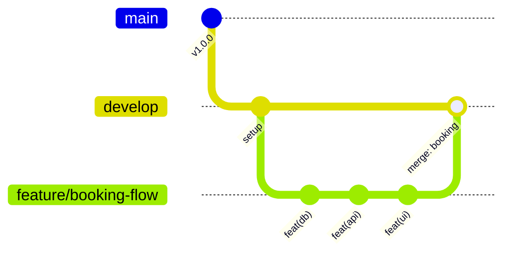

# Enterprise Git Workflow & Kỷ Luật Phát Triển Phần Mềm (Hệ Thống Salon Hair)

> **CẤP ĐỘ:** BẮT BUỘC TUÂN THỦ (MANDATORY). Áp dụng cho mọi tương tác lập trình, sửa lỗi và nâng cấp hệ thống.  
> **CẨM NANG CHI TIẾT ĐẦY ĐỦ:** Xem tài liệu tham chiếu 35.000 ký tự tại [docs/standards/git-workflow-handbook.md](file:///d:/hay/docs/standards/git-workflow-handbook.md).

---

## 1. NGUYÊN TẮC CỐT LÕI (5 NGUYÊN TẮC VÀNG)

1. **Human-in-the-Loop (Con người nắm quyền tối thượng)**: AI Agent là trợ lý thực thi có trách nhiệm, không được tự ý vượt quyền phê duyệt của kỹ sư con người.
2. **Zero-Assumption (Tuyệt đối không đoán mò)**: Nghiệp vụ chưa rõ ràng về phân quyền, tính tiền hay CSDL bắt buộc phải hỏi lại để làm rõ.
3. **Atomic Commits (Commit nguyên tử theo 5 nhóm)**: Cấm tuyệt đối `git add .`. Mỗi commit chỉ phản ánh một tầng kiến trúc độc lập.
4. **Main Sanctity (Nhánh main bất khả xâm phạm)**: Cấm commit hoặc push trực tiếp vào `main`. Nhánh `main` chỉ nhận code ổn định từ release hoặc hotfix khẩn cấp.
5. **Non-Fast-Forward Merge**: Luôn dùng cờ `--no-ff` khi merge vào `develop` để giữ nguyên sơ đồ nhánh trong lịch sử Git.

---

## 2. KIẾN TRÚC PHÂN NHÁNH (BRANCHING STRATEGY)



- **`main`**: Mã nguồn sản phẩm thực tế. Được bảo vệ nghiêm ngặt.
- **`develop`**: Nhánh tích hợp chính cho môi trường phát triển và thử nghiệm.
- **`feature/<ten-tinh-nang>`**: Rẽ nhánh từ `develop`. Phát triển chức năng mới (Ví dụ: `feature/white-orange-theme`).
- **`fix/<ten-loi>`**: Rẽ nhánh từ `develop`. Sửa lỗi kiểm thử trong sprint (Ví dụ: `fix/otp-timer-reset`).
- **`hotfix/<ten-su-co>`**: Rẽ nhánh trực tiếp từ `main`. Vá lỗi khẩn cấp P0 trên Production, sau đó dual-merge về cả `main` và `develop`.

---

## 3. LUỒNG XỬ LÝ 6 BƯỚC TUẦN TỰ & 2 CỔNG CHẶN HUMAN GATES

Mọi yêu cầu lập trình từ người dùng BẮT BUỘC tuân thủ chu trình 6 bước khép kín:

### BƯỚC 1: Phân Tích & Rà Soát Phạm Vi Toàn Diện
- Phân tích yêu cầu chức năng (FR) và phi chức năng (NFR).
- Rà soát ma trận tác động 5 tầng: CSDL SQLite, Backend API, Frontend Template, Static CSS/JS, và Môi trường.
- Chủ động hỏi lại người dùng nếu yêu cầu thiếu thông số kỹ thuật.

### BƯỚC 2: Quản Lý Phân Nhánh Git
- Kiểm tra `git status`. Cập nhật `git pull origin develop`.
- Tạo nhánh làm việc: `git checkout -b feature/<ten-chuc-nang>`.
- Báo cáo rõ tên nhánh hiện tại cho người dùng.

### BƯỚC 3: Lập Blueprint Kỹ Thuật Tại `docs/plans/<ten-feature>.md`
- Soạn thảo bản thiết kế chi tiết gồm 5 phần bắt buộc:
  1. Bối cảnh & Mục tiêu nghiệp vụ.
  2. Ma trận phân tích tác động (Impact Matrix các file).
  3. Đặc tả kỹ thuật (Schema CSDL, API RFC 7807, Giao diện CSS/HTML).
  4. Kịch bản kiểm thử (Happy path & Ca biên).
  5. Phương án hoàn tác (Rollback plan).

---

### 🛑 ĐIỂM DỪNG BẮT BUỘC 1 (HUMAN GATE 1)
> [!CAUTION]
> **ĐIỀU KIỆN TIÊN QUYẾT BẢO VỆ MÃ NGUỒN:**
> Sau khi tạo file Blueprint tại `docs/plans/<ten-feature>.md`, Agent **PHẢI DỪNG LẬP TỨC MỌI THAO TÁC VIẾT MÃ**.
> - Không được tự ý mở file code để lập trình trước khi người dùng duyệt.
> - Xuất phản hồi đính kèm link file Blueprint và chờ người dùng duyệt.
> - **Chỉ khi người dùng phản hồi xác nhận** (ví dụ: *"Đồng ý"*, *"Tiến hành đi"*, *"OK"*), Agent mới được phép bước sang BƯỚC 4.

---

### BƯỚC 4: Viết Mã Sạch & Commit Nguyên Tử Theo 5 Nhóm File
- Thực hiện đúng theo Blueprint đã được phê duyệt.
- Tuân thủ PEP 8 (Python), Clean Code, Semantic HTML5, CSS Neo-Glassmorphism, Vanilla JS ES6+.
- **Chia commit thành 5 nhóm file độc lập (CẤM gõ `git add .`):**

| Nhóm | Tầng Kiến Trúc | Các File Đại Diện | Cú Pháp Commit Chuẩn |
| :---: | :--- | :--- | :--- |
| **Nhóm 1** | Cơ sở dữ liệu & Migrations | `database/*`, `models/*.py`, `.sql` | `feat(db): <mô tả>` hoặc `fix(db): <mô tả>` |
| **Nhóm 2** | Backend API & Dịch vụ | `backend/services/*.py`, `backend/routes/*.py`, `app.py` | `feat(api): <mô tả>` hoặc `fix(api): <mô tả>` |
| **Nhóm 3** | Frontend Templates | `templates/*.html` | `feat(ui): <mô tả>` hoặc `fix(ui): <mô tả>` |
| **Nhóm 4** | Static Assets (CSS & JS) | `static/css/*.css`, `static/js/*.js`, ảnh | `feat(style): <mô tả>` hoặc `fix(style): <mô tả>` |
| **Nhóm 5** | Cấu hình, CI/CD, Docs & Test| `docs/*`, `Dockerfile`, `tests/*` | `chore(config): ...`, `docs: ...`, `test: ...` |

### BƯỚC 5: Tự Kiểm Tra Đa Tầng & Lập Báo Cáo Nghiệm Thu
- Tự chạy kiểm tra cú pháp: `python -m py_compile ...` và `node -c ...`.
- Xác nhận tiến trình máy chủ Uvicorn hoạt động ổn định, nạp đúng route mới.
- Gửi request kiểm thử API trả về mã HTTP 200 OK và dữ liệu đúng chuẩn.
- Kiểm tra giao diện hiển thị, đảm bảo không có lỗi Console F12.
- Xuất báo cáo nghiệm thu tóm tắt các file đã sửa đổi và hướng dẫn kiểm thử.

---

### 🛑 ĐIỂM DỪNG BẮT BUỘC 2 (HUMAN GATE 2)
> [!CAUTION]
> **ĐIỀU KIỆN TIÊN QUYẾT BẢO VỆ NHÁNH CODE:**
> Sau khi xuất Báo Cáo Nghiệm Thu ở Bước 5, Agent **PHẢI DỪNG LẠI HOÀN TOÀN VÀ CHỜ ĐỢI**.
> - TUYỆT ĐỐI CẤM tự ý gõ lệnh `git push` lên bất kỳ remote branch nào.
> - TUYỆT ĐỐI CẤM tự ý checkout sang `develop` hay `main` để merge.
> - **Chỉ khi người dùng tự kiểm thử thực tế và ra lệnh rõ ràng** (ví dụ: *"Push lên git"*, *"Merge vào develop đi"*), Agent mới được thực hiện BƯỚC 6.

---

### BƯỚC 6: Đóng Gói, Push Remote, Tạo PR & Merge Release
- Đẩy mã nguồn lên feature branch: `git push -u origin feature/<ten-chuc-nang>`.
- Merge an toàn vào nhánh `develop`:
  ```bash
  git checkout develop
  git pull origin develop
  git merge --no-ff feature/<ten-chuc-nang> -m "merge: integrate feature/<ten-chuc-nang> into develop"
  git push origin develop
  git branch -d feature/<ten-chuc-nang>
  ```
- Đánh dấu trạng thái hoàn tất trong file Blueprint: `Trạng thái: COMPLETED`.

---

## 4. CẨM NANG THAO TÁC GIT THỰC CHIẾN

```bash
# Hủy bỏ hàng đợi khi lỡ gõ git add .
git restore --staged .

# Sửa lại commit gần nhất (quên file hoặc sửa message)
git commit --amend -m "feat(api): update logic and add missing file"

# Hủy commit gần nhất nhưng giữ nguyên mã đã viết
git reset --soft HEAD~1

# Hủy bỏ hoàn toàn merge khi gặp xung đột rối rắm
git merge --abort

# Cất tạm mã đang viết dở để làm việc khác
git stash push -m "WIP: modal quen mat khau"
git stash pop

# Đồng bộ nhanh với develop
git fetch origin && git merge origin/develop
```

---

## 5. BẢO VỆ BÍ MẬT & CÁC ĐIỀU CẤM TUYỆT ĐỐI

1. ❌ **CẤM COMMIT THÔNG TIN NHẠY CẢM**: Không commit file `.env`, API Keys thật, mật khẩu tài khoản, file `*.db` chứa dữ liệu thật khách hàng.
2. ❌ **CẤM FORCE PUSH (`git push -f`)**: Tuyệt đối không dùng cờ `--force` trên các nhánh dùng chung (`main`, `develop`).
3. ❌ **CẤM VƯỢT RÀO KIỂM SOÁT**: Tuyệt đối không tự ý code khi chưa duyệt Blueprint (Human Gate 1) và không tự ý push khi chưa có lệnh (Human Gate 2).

---

## 6. PRE-FLIGHT CHECKLIST TRƯỚC MỖI PHẢN HỒI

- [ ] 1. Đã phân tích đủ ma trận tác động và không đoán mò logic?
- [ ] 2. Đã dừng lại chờ User duyệt tại Human Gate 1 (nếu vừa lập Blueprint)?
- [ ] 3. Đã chia commit thành các commit nhỏ theo đúng 5 nhóm file độc lập?
- [ ] 4. Đã tự kiểm tra cú pháp Python/JS và gọi thử API HTTP 200 OK?
- [ ] 5. Đã dừng lại chờ User kiểm thử tại Human Gate 2 (không tự ý push)?
- [ ] 6. Giao diện đạt chuẩn Trắng - Cam sang trọng, sạch bóng icon emoji trong nội bộ?
