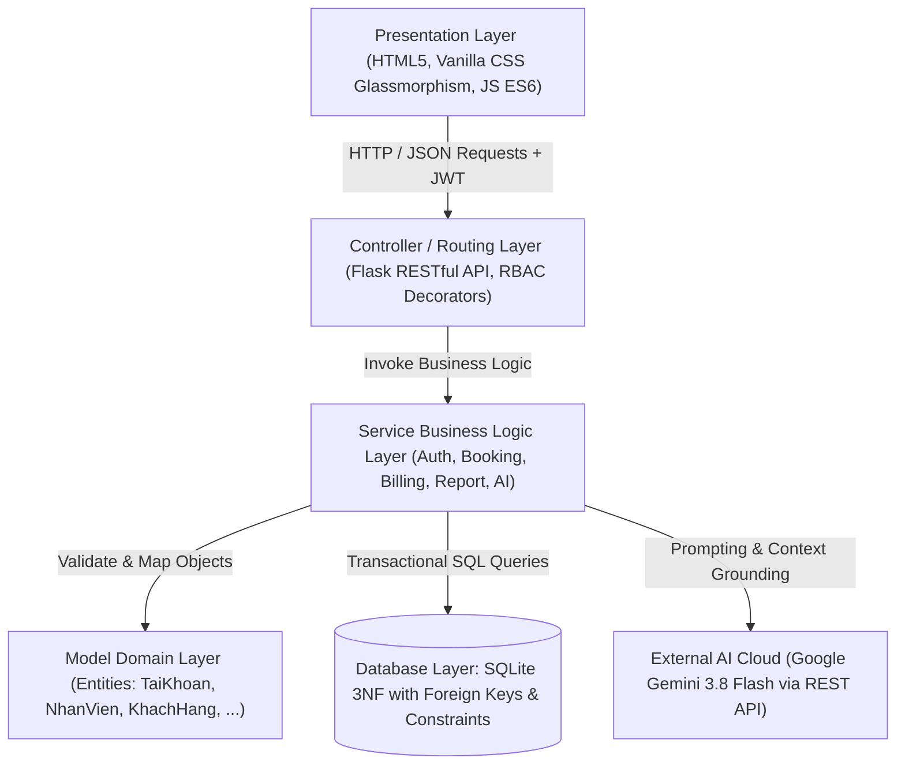
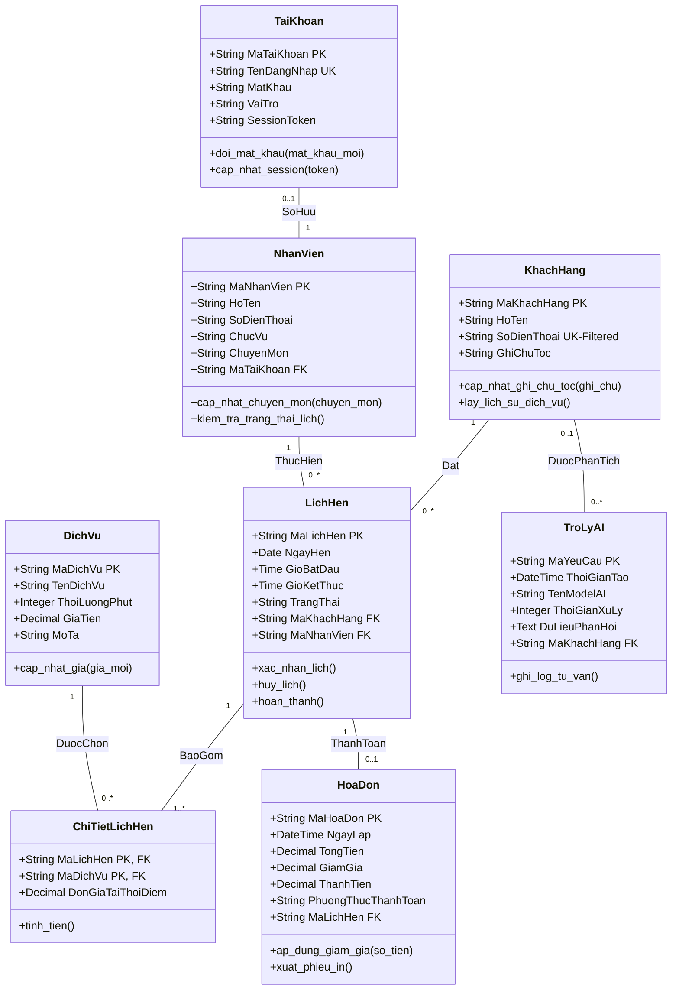
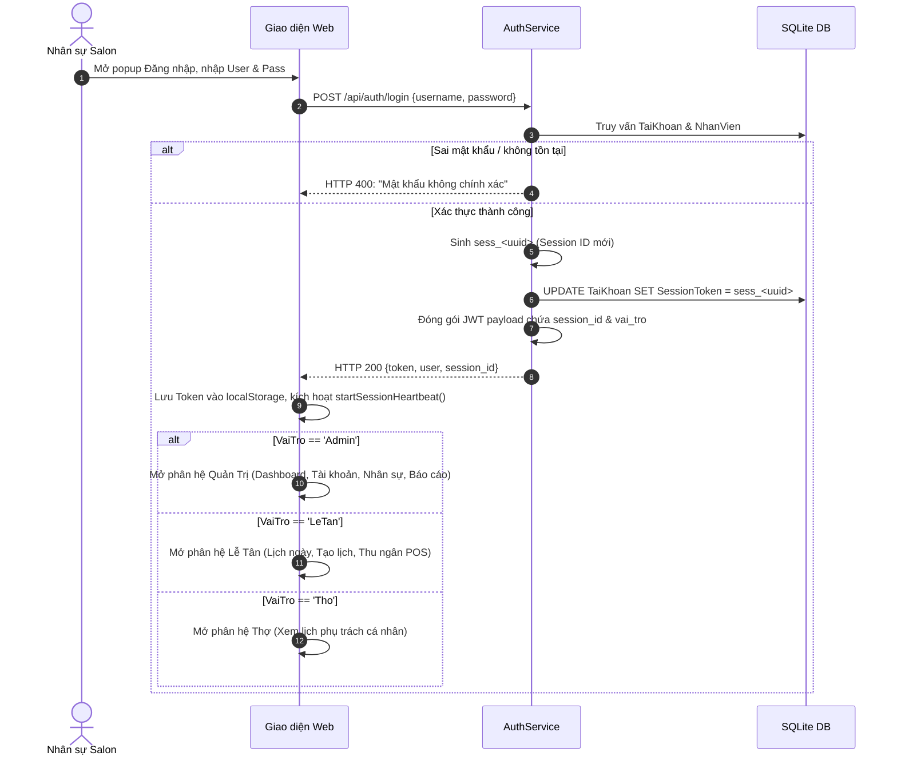
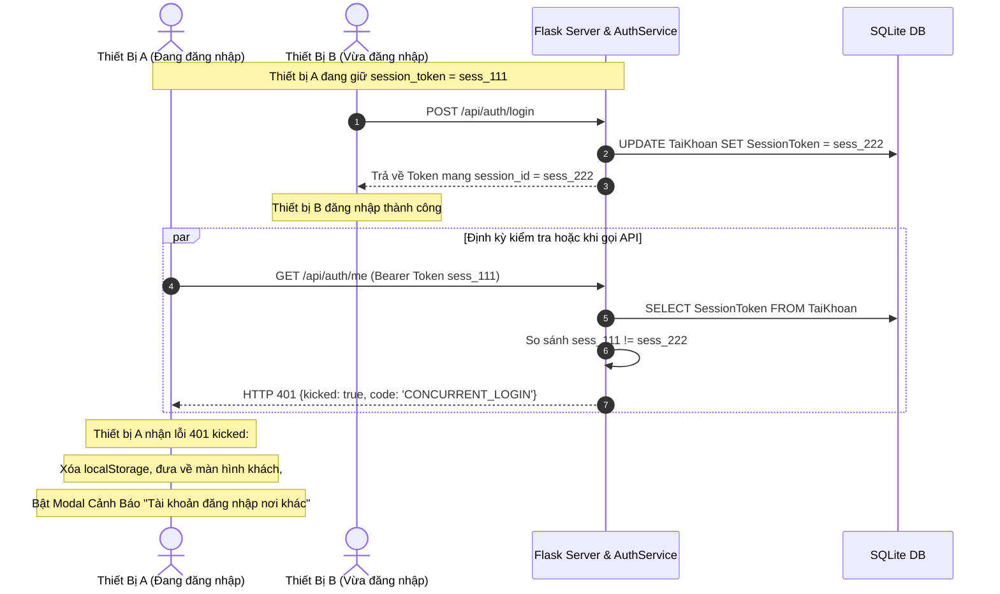

# Architecture Design Skill (Kỹ Năng Thiết Kế Kiến Trúc Phần Mềm)

## 1. Mục Tiêu & Nguyên Lý Cốt Lõi
Xây dựng và bảo trì kiến trúc phần mềm chuẩn **Clean Layered Architecture (Kiến Trúc Phân Tầng Sạch)** cho Hệ Thống Quản Lý Đặt Lịch Salon Tóc Tích Hợp AI. Kiến trúc tách bạch rõ ràng giữa giao diện hiển thị, điều phối API, nghiệp vụ lõi, ánh xạ mô hình và cơ sở dữ liệu quan hệ, đồng thời tích hợp chặt chẽ cơ chế kiểm soát đơn phiên (Single-Device Session) và động cơ AI 2 tầng (Dual-Engine AI).

---

## 2. Tiêu Chuẩn Phân Tầng (Layered Architecture Standards)

### 2.1. Presentation Layer (`templates/index.html`, `static/js/app.js`, `static/css/style.css`)
- **Nguyên tắc**: Sử dụng Vanilla JS và CSS thuần theo phong cách Neo-Glassmorphism sang trọng, không phụ thuộc framework nặng nề, tương thích 100% môi trường trình duyệt máy trạm POS và di động.
- **Trách nhiệm**:
  - Quản lý trạng thái client trong đối tượng toàn cục `state` (`authToken`, `currentRole`, `currentUser`, `appointments`, `services`, `customers`, `stylists`).
  - Giao tiếp máy chủ qua hàm tiện ích `authFetch()` tự động đính kèm `Authorization: Bearer <token>` và bắt mã `401 CONCURRENT_LOGIN`.
  - Cơ chế **Session Heartbeat** tự động kiểm tra mỗi 3.5 giây (`startSessionHeartbeat()`) để phát hiện thiết bị khác đăng nhập và bật popup cảnh báo `#modal-session-kicked`.

### 2.2. Controller / Routing Layer (`backend/routes/api.py`, `app.py`)
- **Nguyên tắc**: RESTful conventions, chuẩn hóa định dạng trả về JSON `{ "success": true/false, "data": ..., "message": ... }`.
- **Trách nhiệm**:
  - Parse request data, query params và headers.
  - Áp dụng bộ lọc bảo mật phân quyền `@require_auth(roles=['Admin', 'LeTan', 'Tho'])`.
  - Tuyệt đối **không** viết logic nghiệp vụ phức tạp (như tính toán xung đột giờ, chiết khấu hóa đơn) trực tiếp trong Route handler; toàn bộ phải chuyển giao xuống Service Layer.

### 2.3. Service Business Logic Layer (`backend/services/`)
Tách thành 5 dịch vụ nghiệp vụ chuyên trách:
1. `AuthService` (`auth_service.py`): Xác thực tài khoản, băm mật khẩu, sinh JWT, cấp phát `SessionToken` duy nhất để vô hiệu hóa phiên cũ.
2. `BookingService` (`booking_service.py`): Thuật toán kiểm tra lịch thợ rảnh, phát hiện giao thoa thời gian `(S1 < E2) AND (S2 < E1)`, tính tổng thời lượng dịch vụ.
3. `BillingService` (`billing_service.py`): Tạo hóa đơn thanh toán, tính toán `ThanhTien = TongTien - GiamGia`, cập nhật trạng thái lịch hẹn sang `Đã thanh toán`.
4. `ReportService` (`report_service.py`): Thống kê doanh thu theo ngày/tháng, tỷ lệ phân bổ dịch vụ, xuất file báo cáo CSV cho Admin.
5. `TroLyAIService` (`tro_ly_ai.py`): Động cơ AI 2 tầng:
   - **Tầng 1 (Local)**: Grounded SQLite Engine đối chiếu trực tiếp dữ liệu CSDL salon và bộ 43+ quy tắc tóc học Trichology.
   - **Tầng 2 (Cloud)**: Google Gemini Cloud AI (`gemini-3.8-flash`) tiếp nhận ngữ cảnh nội bộ để hành văn tự nhiên, mượt mà và thực thi lệnh nghiệp vụ (AI Copilot).

### 2.4. Model / Domain Entity Layer (`backend/models/entities.py`)
- Định nghĩa 8 lớp đối tượng thực thể: `TaiKhoan`, `NhanVien`, `KhachHang`, `DichVu`, `LichHen`, `ChiTietLichHen`, `HoaDon`, `TroLyAI`.
- Cung cấp các phương thức chuyển đổi `to_dict()`, `from_row()` giúp chuẩn hóa dữ liệu giữa SQL tuple và JSON payload.

### 2.5. Data Access Layer (`backend/db.py`, `database/schema.sql`)
- Kết nối SQLite với chế độ `sqlite3.Row` cho phép truy xuất cột theo tên.
- Kích hoạt `PRAGMA foreign_keys = ON;` bắt buộc trong mọi kết nối để đảm bảo toàn vẹn tham chiếu.

---

## 3. Sơ Đồ Lớp Dữ Liệu (Class Diagram - 8 Thực Thể)

---

## 4. Luồng Màn Hình Nghiệp Vụ (Screen Flow 1 - 4)

### Screen Flow 1: Đăng Nhập, Cấp Phiên & Điều Hướng Phân Quyền (RBAC)

### Screen Flow 2: Đặt Lịch Hẹn & Tích Hợp AI Cố Vấn Dịch Vụ
1. **Bước 1**: Chọn hoặc thêm mới Khách Hàng (Tên, SĐT, Ghi chú chất tóc).
2. **Bước 2**: Nhấn nút `✨ AI Gợi Ý Dịch Vụ`: AI phân tích chất tóc (như tóc tẩy level 8, da đầu gàu ngứa) để đề xuất dịch vụ thích hợp.
3. **Bước 3**: Chọn Dịch Vụ: Hệ thống tự động tính tổng thời lượng dự kiến.
4. **Bước 4**: Chọn Thợ Phụ Trách: Hệ thống lọc danh sách thợ rảnh, chặn chọn thợ bị trùng khoảng giờ `(S1 < E2) AND (S2 < E1)`.
5. **Bước 5**: Bấm `Lưu Lịch Hẹn`: Ghi đồng thời vào bảng `LichHen` và `ChiTietLichHen`.

### Screen Flow 3: Thu Ngân POS, Giảm Giá & In Hóa Đơn
1. Lễ tân chọn lịch hẹn hoàn thành từ danh sách trạng thái `Chờ phục vụ` hoặc `Đang làm`.
2. Kiểm tra danh sách dịch vụ đã làm, có thể thêm dịch vụ phát sinh hoặc nhập số tiền giảm giá (`GiamGia <= TongTien`).
3. Chọn phương thức thanh toán: `Tiền mặt`, `Chuyển khoản`, hoặc `Thẻ`.
4. Bấm `Thanh Toán & In Hóa Đơn`: Hệ thống kiểm tra ràng buộc `ThanhTien = TongTien - GiamGia`, ghi bảng `HoaDon`, cập nhật trạng thái lịch hẹn sang `Đã thanh toán` và mở cửa sổ in hóa đơn chuẩn Salon.

### Screen Flow 4: Phân Hệ Quản Trị Viên (Admin Control Center)
- **Quản lý Dịch vụ**: Thêm/Sửa giá, thời lượng, mô tả dịch vụ.
- **Quản lý Đội ngũ Thợ**: Thêm stylist, cập nhật chuyên môn, phân công ca trực.
- **Quản lý Tài khoản Đăng nhập**: Thêm tài khoản mới, phân quyền Admin/LeTan/Tho, cấp tài khoản cho thợ, đổi mật khẩu và thu hồi tài khoản.
- **Báo cáo & Thống kê Tài chính**: Biểu đồ doanh thu ngày/tháng, top dịch vụ sinh lời, nút xuất báo cáo `CSV Export`.

---

## 5. Kiến Trúc Bảo Mật Đơn Phiên (Single-Device Session Architecture)

Để ngăn chặn tình trạng nhiều nhân viên dùng chung một tài khoản đăng nhập trên nhiều máy tính/điện thoại gây thất thoát doanh thu hoặc sai lệch thao tác:

---

## 6. Ma Trận Phân Quyền (RBAC Security Matrix)

| Chức Năng / Endpoint | Khách (Guest) | Thợ (Tho) | Lễ Tân (LeTan) | Quản Lý (Admin) |
| :--- | :---: | :---: | :---: | :---: |
| Xem bảng giá & Dịch vụ | ✅ | ✅ | ✅ | ✅ |
| Chat với Trợ lý AI Stylist | ✅ | ✅ | ✅ | ✅ |
| Xem lịch hẹn của chính mình | ❌ | ✅ | ✅ | ✅ |
| Tạo lịch hẹn mới & Khách hàng | ❌ | ❌ | ✅ | ✅ |
| Thu ngân POS & Xuất hóa đơn | ❌ | ❌ | ✅ | ✅ |
| Quản lý danh mục Dịch vụ (CRUD) | ❌ | ❌ | ❌ | ✅ |
| Quản lý Nhân sự & Phân ca | ❌ | ❌ | ❌ | ✅ |
| Quản lý Tài khoản & Đổi mật khẩu | ❌ | ❌ | ❌ | ✅ |
| Báo cáo doanh thu & Xuất CSV | ❌ | ❌ | ❌ | ✅ |
