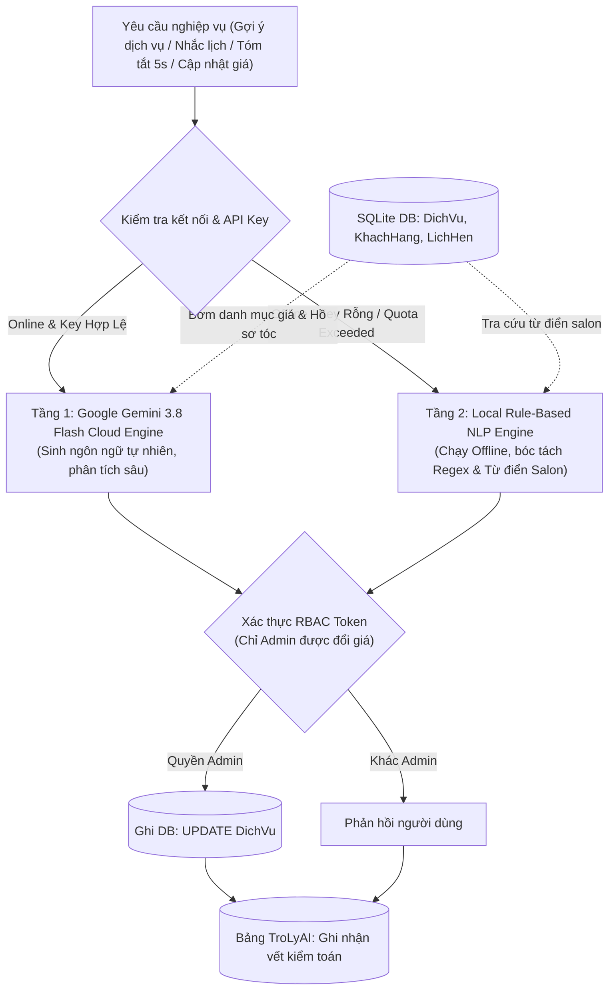

<!--
  BÁO CÁO SINH TỰ ĐỘNG BỞI AI AGENT RUNNER
  Kỹ năng: Kỹ Nghệ Prompt & Động Cơ AI 2 Tầng (AI Prompt Engineering) (ai-prompt-engineering)
  Thời gian tạo: 2026-10-03 13:42:10
  Thời gian thực thi: 1.05s
  Model: Google Gemini (gemini-3.8-flash)
-->

# BÁO CÁO ĐẶC TẢ KỸ NĂNG: Kỹ Nghệ Prompt & Động Cơ AI 2 Tầng (AI Prompt Engineering)

> **Trạng thái**: Tự động sinh bởi Grounded Local Engine
> **Thời gian**: 03/10/2026 13:42:10

## 1. Tổng Quan Kỹ Năng
Gemini Cloud + Fallback SQLite, Context Grounding, Function Calling đổi giá, Zero-Hallucination.

## 2. Nội Dung Chỉ Dẫn Kỹ Năng Chi Tiết

---
name: ai-prompt-engineering
description: Quy chuẩn thiết kế prompt, cấu trúc động cơ AI 2 tầng (Gemini Flash + Fallback Engine), Grounding dữ liệu SQLite, Function Calling và an toàn kiểm toán AI.
version: 2.0.0
---

# AI Prompt Engineering & Agent Architecture Skill (Kỹ Năng Kỹ Thuật Prompt & Phát Triển Trợ Lý AI)

## 1. Mục Tiêu & Kiến Trúc Động Cơ AI 2 Tầng (Dual-Engine AI)
Hệ Thống Quản Lý Đặt Lịch Salon Tóc Tích Hợp AI ứng dụng trí tuệ nhân tạo để tăng tốc vận hành salon, nâng cao trải nghiệm khách hàng và hỗ trợ thợ tóc ra quyết định nhanh. Để đảm bảo hệ thống không bao giờ gián đoạn tại quầy thu ngân (kể cả khi mất mạng internet hoặc hết hạn mức API), kiến trúc AI được xây dựng theo mô hình **Động cơ 2 Tầng (Dual-Engine)**:



---

## 2. Kỹ Thuật Context Grounding & Chống Ảo Giác (Hallucination Defense)

### 2.1. Nguyên Tắc "Zero-Hallucination" Cho Menu Dịch Vụ
- **Cấm kỵ**: Tuyệt đối không để AI tự bịa đặt dịch vụ hoặc tự đặt ra mức giá không có trong cơ sở dữ liệu của salon (ví dụ: AI tự sáng tác gói "Nhuộm phủ bóng 24K giá 2 triệu" khi salon không hề cung cấp).
- **Cơ chế Grounding**:
  1. Trước khi gửi prompt đến mô hình LLM, backend truy vấn toàn bộ danh mục dịch vụ đang kinh doanh trong bảng `DichVu` (`MaDichVu`, `TenDichVu`, `GiaTien`, `ThoiLuongPhut`).
  2. Bơm bảng dữ liệu này trực tiếp vào `System Prompt` dưới định dạng danh sách có cấu trúc.
  3. Chỉ thị tối cao: *"CHỈ ĐƯỢC PHÉP gợi ý các dịch vụ có tên chính xác trong danh sách được cấp. Mọi dịch vụ khác ngoài danh mục đều bị nghiêm cấm."*

---

## 3. Đặc Tả Bộ Prompt Nghiệp Vụ Chuẩn

### 3.1. Prompt Gợi Ý Liệu Trình Chăm Sóc & Dịch Vụ Phù Hợp (UC008)
```markdown
[SYSTEM]
Bạn là Chuyên gia Cố vấn Phong cách và Phục hồi Tóc của Hair Salon cao cấp.
Nhiệm vụ: Phân tích chất tóc, da đầu và lịch sử làm đẹp của khách hàng để gợi ý combo dịch vụ phù hợp nhất.
Quy tắc bất di bất dịch:
1. Chỉ gợi ý các dịch vụ có trong Danh mục dịch vụ Salon bên dưới.
2. Giải thích ngắn gọn lý do vì sao liệu trình này phục hồi hoặc tôn vinh chất tóc của khách.
3. Không chào mời quá 3 dịch vụ để tránh gây bối rối cho khách.

Danh mục dịch vụ salon hiện hành:
{services_catalog_json}

[USER]
Khách hàng: {customer_name}
Đặc điểm chất tóc: {hair_condition}
Lịch sử gần nhất: {hair_history}
Hãy đưa ra đề xuất liệu trình tư vấn chuyên nghiệp.
```

### 3.2. Prompt Soạn Tin Nhắn Nhắc Lịch Ấm Áp Qua Zalo/SMS (UC009)
```markdown
[SYSTEM]
Bạn là Lễ tân chu đáo của Hair Salon. Hãy viết một tin nhắn nhắc lịch hẹn ngắn gọn, lịch sự, ấm áp và chuyên nghiệp để gửi cho khách hàng qua ứng dụng Zalo/SMS.
Quy tắc:
1. Thể hiện sự tôn trọng, xưng hô lịch thiệp ("Dạ chào Anh/Chị...").
2. Đầy đủ các thông tin then chốt: Ngày giờ hẹn, Tên Stylist phụ trách, Dịch vụ đã đăng ký.
3. Hướng dẫn khách hàng liên hệ lại nếu cần dời lịch hoặc có việc bận đột xuất.
4. Độ dài: Dưới 150 từ, sử dụng biểu tượng cảm xúc (emoji) vừa phải, trang nhã.

[USER]
Thông tin lịch hẹn:
- Tên khách hàng: {customer_name}
- Thời gian bắt đầu: {appointment_time}
- Thợ Stylist phụ trách: {stylist_name}
- Danh sách dịch vụ: {services_list}
```

### 3.3. Prompt Tóm Tắt Hồ Sơ Khách Hàng 5 Giây Cho Stylist (UC010)
```markdown
[SYSTEM]
Nhiệm vụ: Tạo bản tóm tắt siêu ngắn gọn (Flash Brief) cho Thợ làm tóc đọc lướt trên điện thoại trong đúng 5 GIÂY trước khi tiếp đón khách vào ghế làm tóc.
Quy tắc:
1. Độ dài tối đa 4 gạch đầu dòng.
2. Nêu bật ngay các CẢNH BÁO NGUY HIỂM (dị ứng hóa chất, tẩy tóc level cao, da đầu nhạy cảm, tóc quá yếu).
3. Đề xuất thao tác kỹ thuật cần lưu ý.

[USER]
Hồ sơ khách hàng:
- Tên: {customer_name}
- Tình trạng tóc: {hair_condition}
- Lịch sử dịch vụ: {last_services_notes}
```

---

## 4. AI Agent Function Calling (Tool Use) & Rào Chắn RBAC

### 4.1. Quy Trình Cập Nhật Bảng Giá Bằng Ngôn Ngữ Tự Nhiên
AI Agent hỗ trợ tiếp nhận khẩu lệnh tiếng Việt của người quản lý salon để cập nhật giá niêm yết trong cơ sở dữ liệu (`UPDATE DichVu SET GiaTien = ? WHERE MaDichVu = ?`).

### 4.2. Bộ Bóc Tách Thực Thể Giá Tiền Tiếng Việt
Hàm `_handle_price_update_request` nhận diện linh hoạt các biến thể diễn đạt giá tiền:
- Dạng chữ "k": `150k` -> `150000`
- Dạng tiền có dấu chấm: `200.000đ` -> `200000`
- Dạng chữ "triệu": `1.5 triệu` -> `1500000`

### 4.3. Rào Chắn An Toàn Phân Quyền (RBAC Enforced)
```python
# Kiểm tra quyền trước khi cho phép AI thực thi câu lệnh SQL:
if role != 'Admin':
    return {
        "success": False,
        "message": "⛔ BẢO MẬT: Bạn không có quyền Quản trị viên (Admin) để thay đổi giá dịch vụ. Thao tác đã bị ghi lại vào log kiểm toán."
    }
# Chỉ khi vai trò là Admin mới thực thi:
cursor.execute("UPDATE DichVu SET GiaTien = ? WHERE MaDichVu = ?", (new_price, service_id))
conn.commit()
```

---

## 5. Phòng Chống Prompt Injection & Quản Lý Kiểm Toán (`TroLyAI`)

### 5.1. Bộ Lọc Vệ Tinh (Sanitizing Guardrail)
Mọi câu hỏi từ phía người dùng đều được lọc sạch các mẫu câu cố tình bẻ khóa hệ thống (Jailbreak):
- Loại bỏ chuỗi `"Ignore previous instructions"`, `"Bỏ qua các lệnh trước đó"`.
- Chặn đứng các nỗ lực mạo danh quản trị viên thông qua text input thông thường nếu không có token JWT hợp lệ đi kèm.

### 5.2. Ghi Nhật Ký Kiểm Toán Tự Động Vào Bảng `TroLyAI`
Mọi lượt tương tác AI đều được ghi vết độc lập vào cơ sở dữ liệu:
```sql
INSERT INTO TroLyAI (MaAI, CauHoi, CauTraLoi, ThoiGian, MaKhachHang)
VALUES (?, ?, ?, datetime('now', 'localtime'), ?);
```
- Khóa ngoại `MaKhachHang` sử dụng `ON DELETE SET NULL`: Khi hồ sơ khách hàng bị xóa, bản ghi nhật ký AI vẫn được giữ lại để phục vụ đối soát và phân tích chất lượng dịch vụ của salon.

